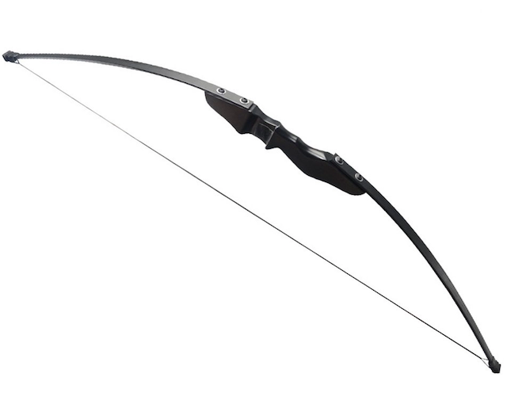

<!DOCTYPE html>
<html lang="pt-BR">
<head>
<meta charset="UTF-8">
<meta name="viewport" content="width=device-width, initial-scale=1.0">

<title>Vitrine de Ofertas | Achados para Campo, Casa e Lazer</title>
<meta name="description" content="Encontre listas e produtos selecionados para caça esportiva, arco e flecha, pesca, campo, casa, tecnologia e lazer. Acesse nossas indicações no Mercado Livre.">
<meta name="keywords" content="Vitrine de Ofertas, caça esportiva, arco e flecha, besta, carabina de pressão, chumbinho, pesca, produtos rurais, ofertas Mercado Livre">
<meta name="author" content="Vitrine de Ofertas">
<meta name="robots" content="index, follow">
<meta name="theme-color" content="#17251d">
<link rel="canonical" href="https://marquesdvoferta.github.io/">

<meta property="og:type" content="website">
<meta property="og:title" content="Vitrine de Ofertas">
<meta property="og:description" content="Achados selecionados para campo, casa, lazer e tecnologia.">
<meta property="og:url" content="https://marquesdvoferta.github.io/">

</head>

<body>

<header>
    

        <a href="#inicio" class="logo">
            
✦

            
Vitrine de Ofertas

        </a>
        
CURADORIA INDEPENDENTE DE PRODUTOS

    

</header>

<nav aria-label="Menu principal">
    

        <a href="#inicio">Início</a>
        <a href="#caca">Lista de caça</a>
        <a href="#categorias">Categorias</a>
        <a href="#destaques">Achados</a>
        <a href="#sobre">Sobre a vitrine</a>
    

</nav>

<main class="container">

    <!-- APRESENTAÇÃO -->
    <section class="hero" id="inicio">
        

            
Vitrine de Ofertas • Seleção especial

            <h1>Encontre o que combina com seu estilo de vida.</h1>
            

                Uma vitrine independente com listas e sugestões de produtos
                para quem gosta de campo, natureza, casa, lazer e tecnologia.
                Explore as categorias e encontre seus próximos achados.
            

            <a href="#caca" class="botao botao-dourado">
                Explorar lista em destaque →
            </a>
        

    </section>

    <!-- CAÇA EM PRIMEIRO LUGAR -->
    <section class="destaque-caca" id="caca">

        

            

                
Seleção em destaque

                <h2>Caça, arco e flecha</h2>
                

                    Acesse a lista de produtos selecionados no Mercado Livre
                    e explore equipamentos, acessórios e artigos relacionados.
                    Esta é a área principal da nossa vitrine.
                

            

            LISTA EM DESTAQUE
        

        

            <article class="caca-card">
                
                

                    <h3>Arco e flecha</h3>
                    
Equipamentos e acessórios para prática esportiva e recreativa.

                    <a class="botao botao-verde"
                       href="https://meli.la/2YBisqP"
                       target="_blank"
                       rel="nofollow sponsored noopener noreferrer">
                        Ver produtos
                    </a>
                

            </article>

            <article class="caca-card">
                
                

                    <h3>Besta</h3>
                    
Confira produtos e acessórios disponíveis na lista.

                    <a class="botao botao-verde"
                       href="https://meli.la/2YBisqP"
                       target="_blank"
                       rel="nofollow sponsored noopener noreferrer">
                        Ver produtos
                    </a>
                

            </article>

            <article class="caca-card">
                
                

                    <h3>Chumbinhos e acessórios</h3>
                    
Consulte os anúncios e confira as especificações dos produtos.

                    <a class="botao botao-verde"
                       href="https://meli.la/2YBisqP"
                       target="_blank"
                       rel="nofollow sponsored noopener noreferrer">
                        Ver produtos
                    </a>
                

            </article>

        

        

            

                <strong>🛒 Acesse a lista de caça no Mercado Livre</strong>
                
Veja os produtos reunidos na lista principal da Vitrine de Ofertas.

            

            <a class="botao botao-dourado"
               href="https://meli.la/2YBisqP"
               target="_blank"
               rel="nofollow sponsored noopener noreferrer">
                ACESSAR LISTA →
            </a>
        

        

            Conteúdo destinado à divulgação de produtos. Verifique a legislação
            aplicável, os requisitos de idade, as regras de aquisição e as
            condições de uso dos equipamentos. Respeite as normas de segurança
            e as orientações dos fabricantes.
        

    </section>

    <!-- BUSCA -->
    <section class="painel">
        

            

                <h2>O que você está procurando?</h2>
                
Pesquise uma categoria para encontrar o assunto desejado.

                

            

        

        <form class="busca" id="formBusca">
            <input type="search" id="campoBusca"
                   placeholder="Ex.: pesca, notebook, ferramentas, casa..."
                   aria-label="Pesquisar categorias">
            <button class="botao botao-verde" type="submit">Buscar</button>
        </form>
        

    </section>

    <!-- CATEGORIAS -->
    <section class="painel" id="categorias">
        

            

                <h2>Explore outras categorias</h2>
                
Mais opções para casa, campo, tecnologia, lazer e rotina.

                

            

        

        

            <a class="categoria" data-palavras="notebook computador informática tecnologia laptop"
               href="https://meli.la/1njpbSM" target="_blank" rel="nofollow sponsored noopener noreferrer">
                💻
                <strong>Notebooks</strong><small>Informática e tecnologia</small>
            </a>

            <a class="categoria" data-palavras="eletrodomésticos cozinha casa"
               href="https://meli.la/2jKEBe1" target="_blank" rel="nofollow sponsored noopener noreferrer">
                🍳
                <strong>Eletrodomésticos</strong><small>Produtos para casa</small>
            </a>

            <a class="categoria" data-palavras="natal decoração enfeites"
               href="https://meli.la/1vBQJKs" target="_blank" rel="nofollow sponsored noopener noreferrer">
                🎄
                <strong>Enfeites de Natal</strong><small>Decoração</small>
            </a>

            <a class="categoria" data-palavras="pesca pescaria vara anzol molinete"
               href="https://meli.la/2eDHdYS" target="_blank" rel="nofollow sponsored noopener noreferrer">
                🎣
                <strong>Pescaria</strong><small>Artigos e acessórios</small>
            </a>

            <a class="categoria" data-palavras="pintura tinta reforma acabamento casa"
               href="https://meli.la/1uRP5Jz" target="_blank" rel="nofollow sponsored noopener noreferrer">
                🖌️
                <strong>Pintura e acabamentos</strong><small>Reforma e construção</small>
            </a>

            <a class="categoria" data-palavras="brinquedos crianças infantil jogos"
               href="https://meli.la/333DnWa" target="_blank" rel="nofollow sponsored noopener noreferrer">
                🧸
                <strong>Brinquedos</strong><small>Jogos e presentes</small>
            </a>

            <a class="categoria" data-palavras="revenda produtos negócio comércio empreendedor"
               href="https://meli.la/26pngPX" target="_blank" rel="nofollow sponsored noopener noreferrer">
                📦
                <strong>Produtos para revenda</strong><small>Pequenos negócios</small>
            </a>

            <a class="categoria" data-palavras="material escolar mochila caderno caneta escola"
               href="https://meli.la/2bcp9T1" target="_blank" rel="nofollow sponsored noopener noreferrer">
                🎒
                <strong>Material escolar</strong><small>Estudo e organização</small>
            </a>

            <a class="categoria" data-palavras="tv televisão celular smartphone eletrônicos"
               href="https://meli.la/1cz7b71" target="_blank" rel="nofollow sponsored noopener noreferrer">
                📱
                <strong>TV e celulares</strong><small>Eletrônicos</small>
            </a>

            <a class="categoria" data-palavras="caminhada musculação academia esporte fitness"
               href="https://meli.la/1oX9Gak" target="_blank" rel="nofollow sponsored noopener noreferrer">
                🏃
                <strong>Caminhada e musculação</strong><small>Atividade física</small>
            </a>

            <a class="categoria" data-palavras="rural roça campo fazenda ferramentas agricultura quintal"
               href="https://meli.la/1V523ii" target="_blank" rel="nofollow sponsored noopener noreferrer">
                🌱
                <strong>Achados rurais</strong><small>Campo e quintal</small>
            </a>

        

        

            Nenhuma categoria encontrada. Tente pesquisar por outro termo.
        

    </section>

    <!-- OUTROS ACHADOS -->
    <section class="painel" id="destaques">
        

            

                <h2>Mais achados para descobrir</h2>
                
Algumas sugestões para continuar explorando a vitrine.

                

            

        

        

            <article class="produto">
                
💻

                

                    Tecnologia
                    <h3>Notebooks e computadores</h3>
                    
Opções para estudar, trabalhar e realizar tarefas do dia a dia.

                

                <a class="botao botao-verde" href="https://meli.la/1njpbSM" target="_blank" rel="nofollow sponsored noopener noreferrer">Ver ofertas</a>
            </article>

            <article class="produto">
                
🎣

                

                    Lazer
                    <h3>Equipamentos de pescaria</h3>
                    
Artigos e acessórios para quem gosta de pescar.

                

                <a class="botao botao-verde" href="https://meli.la/2eDHdYS" target="_blank" rel="nofollow sponsored noopener noreferrer">Ver ofertas</a>
            </article>

            <article class="produto">
                
🌾

                

                    Campo
                    <h3>Produtos rurais</h3>
                    
Ferramentas e itens úteis para campo, roça e quintal.

                

                <a class="botao botao-verde" href="https://meli.la/1V523ii" target="_blank" rel="nofollow sponsored noopener noreferrer">Ver ofertas</a>
            </article>

            <article class="produto">
                
🍳

                

                    Casa
                    <h3>Eletrodomésticos</h3>
                    
Produtos para cozinha e praticidade na rotina doméstica.

                

                <a class="botao botao-verde" href="https://meli.la/2jKEBe1" target="_blank" rel="nofollow sponsored noopener noreferrer">Ver ofertas</a>
            </article>

            <article class="produto">
                
🧸

                

                    Infantil
                    <h3>Brinquedos e jogos</h3>
                    
Ideias de presentes e opções para diferentes idades.

                

                <a class="botao botao-verde" href="https://meli.la/333DnWa" target="_blank" rel="nofollow sponsored noopener noreferrer">Ver ofertas</a>
            </article>

            <article class="produto">
                
📦

                

                    Empreendedorismo
                    <h3>Produtos para revenda</h3>
                    
Explore opções para pesquisar e avaliar oportunidades de comércio.

                

                <a class="botao botao-verde" href="https://meli.la/26pngPX" target="_blank" rel="nofollow sponsored noopener noreferrer">Ver ofertas</a>
            </article>

        

    </section>

    <!-- SOBRE -->
    <section class="painel" id="sobre">
        

            

                <h2>Sobre a Vitrine de Ofertas</h2>
                
Uma página independente para organizar indicações de produtos.

                

            

        

        

            

                A Vitrine de Ofertas reúne listas e sugestões de produtos
                em diferentes categorias. A proposta é facilitar a pesquisa
                de quem procura artigos para campo, casa, lazer, tecnologia,
                estudos e atividades do dia a dia.
            

            <h3>Como funcionam os links?</h3>
            

                Alguns links desta página são links de afiliados. Isso significa
                que podemos receber uma comissão quando uma compra qualificada
                é realizada por meio deles, sem custo adicional para o comprador.
            

            <h3>Somos o Mercado Livre?</h3>
            

                Não. A Vitrine de Ofertas é independente e não representa
                oficialmente o Mercado Livre. Não realizamos vendas, pagamentos,
                entregas ou atendimento dos produtos anunciados.
            

            

                <strong>Transparência e segurança:</strong>
                os preços, estoques, condições de pagamento e prazos podem mudar.
                Confira sempre as informações diretamente no anúncio e compre
                pelos canais oficiais da plataforma.
            

        

    </section>

</main>

<footer>
    

        

            <h3>Vitrine de Ofertas</h3>
            

                Achados e sugestões para quem gosta de campo, natureza,
                casa, lazer e tecnologia.
            

            

                Site independente de divulgação de produtos e afiliados.
            

        

        

            <h3>Navegação</h3>
            <a href="#inicio">Página inicial</a>
            <a href="#caca">Lista em destaque</a>
            <a href="#categorias">Categorias</a>
            <a href="#destaques">Mais achados</a>
        

        

            <h3>Informações</h3>
            <a href="#sobre">Sobre a vitrine</a>
            <a href="#sobre">Aviso de afiliados</a>
            <a href="#sobre">Transparência</a>
        

    

    

        © 2026 Vitrine de Ofertas. Site independente.
        Mercado Livre é uma marca de seu respectivo proprietário.
    

</footer>

</body>
</html>
